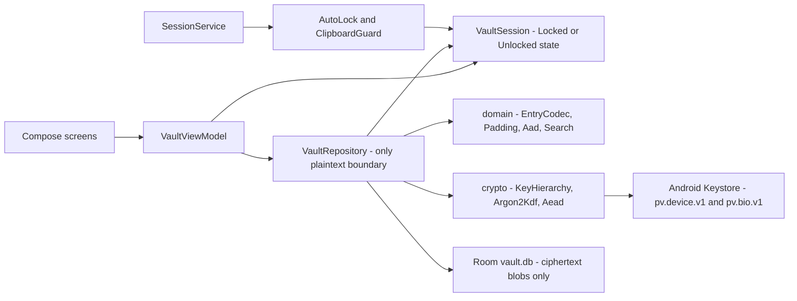

# Vault: offline Android password vault

An offline Android password vault: Argon2id-derived keys, AES-GCM, Android Keystore, biometric unlock.
The APK requests no network permission, and nothing in it syncs.

<!-- screenshot: Unlock screen of the debug build ("Vault is locked", passphrase field empty, "Unlock with biometrics" button visible). FLAG_SECURE blanks normal screenshots: capture from a local debug build with the FLAG_SECURE line in MainActivity.kt commented out (do not commit that). -->
<!-- screenshot: Entry list with 5-6 fake entries only (e.g. "Example Bank" / demo.user, "Home router" / admin, "Mail" / nikola@example.com, "Code host" / demo-dev), tag chips "work" and "bank" under the search box, "Last backup: today" header. -->
<!-- screenshot: Add entry screen with the "Generate password" dialog open in Words mode (6 words, "-" separator, about 77 bits shown), fake title "Example Shop". -->

## The problem

I wanted a password manager on my phone that I could trust with real logins without trusting a server, a sync service
or a cloud backup. Most vault apps are built around sync, and the phone's own credential store opens as soon as the
screen lock does. This app keeps every secret encrypted on the device under a passphrase only I know, binds the
encrypted key to this phone's hardware keystore, and has no way to send anything anywhere.

## Architecture



The UI never sees keys or blobs. `VaultRepository` is the only place where plaintext and Room meet: it decrypts
entry summaries for the list, decrypts a secret only when it is copied, revealed or edited, and encrypts every field
before it is written. `VaultSession` holds the 32-byte vault key in memory while unlocked and zeroes it on every lock.
`AutoLock` and `ClipboardGuard` lock the vault and clear the clipboard on timeouts. `crypto/` and `domain/` are plain
Kotlin with no Android imports, except the two Keystore classes, so the JVM tests run the real crypto.

Full threat model and key hierarchy: [SECURITY.md](SECURITY.md). Design notes and decisions:
[docs/design.md](docs/design.md).

## Stack

- Kotlin, Jetpack Compose (Material 3), coroutines and Flow
- Room 2.7 with exported schemas (`android/app/schemas/`, v1 to v3) and hand-written migrations
- Bouncy Castle `bcprov-jdk18on` for Argon2id only (lightweight API, not the JCA provider)
- Platform JCA AES-256-GCM, HKDF-SHA256 / HMAC-SHA256, Android Keystore (StrongBox when present, else TEE)
- Framework `android.hardware.biometrics.BiometricPrompt` with a `CryptoObject`
- minSdk 28, targetSdk 36, R8 for release builds
- JUnit 4, kotlinx-coroutines-test, sqlite-jdbc (tests only)

## Interesting engineering

- **Two independent locks on the vault key.** A random 32-byte vault key (VK) encrypts the entries. The VK is wrapped
  with AES-256-GCM under a key derived from the passphrase by Argon2id (64 MiB, t calibrated to about 1 s, never
  below 3), and that wrap is wrapped again by a non-exportable Keystore key that only works while the phone is
  unlocked (`crypto/KeyHierarchy.kt`, `crypto/KeystoreDeviceWrap.kt`). Copied app files cannot be attacked off the
  phone, and on the phone every guess still costs a full Argon2id run. The KDF parameters are part of the AAD of the
  passphrase wrap (`domain/Aad.kt`), so a downgraded header fails the GCM tag, and absurd parameters are refused before
  Argon2id runs, so a tampered header cannot exhaust memory.
- **Per-field AEAD instead of a database cipher.** Each entry has two blobs: a summary (title, username, URL,
  timestamps, tags) decrypted for the list, and a secret (password, notes) decrypted only on demand. The AAD binds
  vault id, entry id and field, so a blob moved to another entry, or swapped from summary to secret, does not
  decrypt. Plaintext is padded (ISO/IEC 7816-4) to a multiple of 64 bytes, so blob sizes do not give away password
  lengths (`domain/Padding.kt`, `domain/EntryCodec.kt`).
- **Biometric unlock that does not replace the passphrase.** A second Keystore key (`crypto/KeystoreBiometricKey.kt`)
  needs a fresh Class 3 biometric for every use and is invalidated when a new fingerprint or face is enrolled.
  Turning it on requires the passphrase first, and the passphrase is required again every 7 days. The "last
  passphrase" timestamp is wrapped by the device Keystore key, so it cannot be edited in the database to stretch
  that window, and it is checked again after the prompt (`domain/PassphraseSchedule.kt`, `data/VaultRepository.kt`).
- **Auto-lock that still fires on Android 14+.** Android freezes cached processes, so a 60-second timer may never run
  after the user leaves the app. A small started service (`session/SessionService.kt`) keeps the process out of the
  cached state while the vault is open (and locks the vault if Android stops it), and `AutoLock` re-checks elapsed
  time on `ON_START` before the first frame. The pure timing logic lives in `domain/AutoLockPolicy.kt` and is tested
  with a fake clock.
- **Ciphertext-only backups with a strict parser.** `.pvault` export files (`crypto/BackupFile.kt`) carry the
  passphrase wrap without the device layer, the entry blobs byte for byte, and an HMAC-SHA256 over the whole file
  under a key derived from the VK with HKDF. The parser rejects trailing bytes, duplicate ids and oversize counts;
  tests flip every single bit and try every truncation length of a file.
- **The build refuses network access.** The manifest strips `INTERNET`, `ACCESS_NETWORK_STATE` and
  `ACCESS_WIFI_STATE` if a dependency merges them in, and `android/build-apk.sh` dumps the release APK's permissions
  with `aapt2` and fails on anything outside a two-item allowlist (`USE_BIOMETRIC` and androidx.core's self-scoped
  receiver permission).

## Repository layout

| Path | What |
|------|------|
| `android/app/src/main/java/.../vault/crypto/` | Argon2id, AES-GCM blob format, key hierarchy, Keystore wraps, HKDF, `.pvault` codec |
| `android/app/src/main/java/.../vault/domain/` | Pure Kotlin: TLV entry codec, padding, AAD strings, backoff, auto-lock and clipboard policies, search, tags, generator, settings |
| `android/app/src/main/java/.../vault/data/` | Room entities, DAOs, migrations, `VaultRepository` |
| `android/app/src/main/java/.../vault/session/` | Session state machine, auto-lock, clipboard guard, keep-alive service, backoff store |
| `android/app/src/main/java/.../vault/ui/` | Compose screens, `VaultViewModel`, incognito keyboard, biometric prompt wrapper |
| `android/app/schemas/` | Exported Room schema JSON, v1 to v3 (the migration tests read these) |
| `android/app/src/test/` | 207 JVM unit tests |
| `android/build-apk.sh` | Release build: tests, R8 build, permission gate, signing |
| `SECURITY.md` | Threat model, key hierarchy, reporting |
| `docs/design.md` | Architecture, data model, flows, decisions |

## Run it locally

You need a JDK (17 or newer; the project is built with Temurin 21) and the Android SDK with platform 36 installed.
There is no emulator setup in this repo; the app runs on the author's own phone.

```bash
cd android
echo "sdk.dir=$ANDROID_HOME" > local.properties
./gradlew test             # JVM unit tests
./gradlew assembleDebug    # app/build/outputs/apk/debug/app-debug.apk
adb install -r app/build/outputs/apk/debug/app-debug.apk
```

The debug build installs as a separate app (`com.nnikolovskii.vault.debug`, "Vault debug") with its own data, so it
can never collide with a release install. Only the debug build shows the Argon2id timing line on the Unlock screen.
The phone needs a screen lock before a vault can be created.

**Release build.** `android/build-apk.sh` runs the tests, builds a release APK with R8, runs the permission gate and
signs the APK with your own keystore (it creates an RSA 4096 PKCS12 keystore and a random password file under
`~/.android/` if they are missing). Signing passwords reach `keytool` and `apksigner` through the environment, never
on the command line. The variables it reads are listed in [android/.env.example](android/.env.example). The script
expects Temurin 21 at `~/jdk/temurin-21` and downloads it there (Linux x64) if it is missing. It writes the signed APK
to `vault.apk` at the repository root (ignored by `.gitignore`) and a password-zipped copy to `~/Downloads/vault.zip`
(zip password from `VAULT_ZIP_PASS`).

Keep the signing keystore safe and backed up. Whoever holds it can ship an update that reads the vault, and losing
it means the next build cannot install over the old one. Never uninstall the app to get past a signature mismatch:
that deletes the vault and its Keystore keys.

## Tests

```bash
cd android
./gradlew test                  # debug and release variants
./gradlew testDebugUnitTest     # one variant
```

207 JVM unit tests, all passing on a clean clone. `./gradlew test` runs them for both variants, so it reports 414
runs, 0 failures. The tests run the real Argon2id at 64 MiB (the test JVM gets a 512 MiB heap) and fake only the
Android Keystore. They cover:

- Argon2id against the RFC 9106 test vector and a reference vector at the app's own parameters; the calibrator never
  picks t below 3
- AES-GCM bit flips, AAD binding (moved, swapped and foreign-vault blobs), header tampering and downgrade
- Passphrase NFC handling (precomposed and decomposed Cyrillic), backoff schedule, auto-lock timing with a fake clock,
  clipboard policy, redacted `toString()` on secret-holding classes
- `.pvault` round trip, every truncation and every single-bit flip, change passphrase, restore, biometric flows with a
  fake key, the 7-day rule
- Room migrations 1→2, 2→3 and 1→2→3, run with sqlite-jdbc against the exported schema JSON

What the JVM tests cannot cover (real Keystore behaviour, `FLAG_SECURE`, keyboard and clipboard behaviour on a
device) needs a manual check on a real phone.

## Status and limits

- Personal project, single user, one vault per phone. Version 0.3.0: create, unlock, entries, copy with auto-clear,
  auto-lock, encrypted export and restore, change passphrase, biometric unlock, search, tags, password and passphrase
  generator, timeout settings.
- Not built: an autofill service, TOTP codes, import from other managers. There is no sync and no desktop client.
- Android only (minSdk 28). Release builds are signed by whoever builds them; there is no Play Store listing.
- No independent security audit. The threat model, including what it does not defend against (a compromised OS
  while unlocked, a weak passphrase, JVM memory hygiene limits), is written down in [SECURITY.md](SECURITY.md).
- A forgotten passphrase cannot be recovered. A lost or reset phone means the vault is gone unless a `.pvault` export
  exists somewhere else.

## Licence

MIT, see [LICENSE](LICENSE). The bundled EFF large wordlist
(`android/app/src/main/resources/eff_large_wordlist.txt`) is published by the Electronic Frontier Foundation (eff.org, CC BY 3.0 US)
and ships unmodified; a test checks its SHA-256 against the published file.
