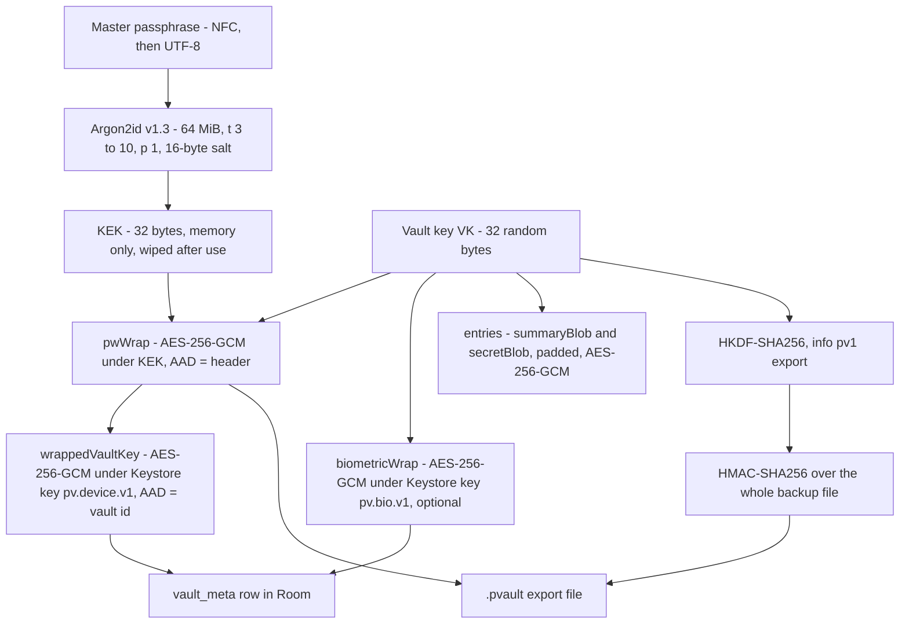

# Security

This document describes what Vault protects, against whom, and how. Every parameter below is taken from the code
under `android/app/src/main/java/com/nnikolovskii/vault/`; file names are given so each claim can be checked.

Vault is a personal project and has not been independently audited.

## Reporting a vulnerability

Please open a private **GitHub security advisory** on this repository (Security tab → "Report a vulnerability").
Include the version (`versionName` in `android/app/build.gradle.kts`), what an attacker needs (files, an unlocked
phone, a backup file), and steps to reproduce. Please do not open a public issue for a vulnerability.

## Design goals

- Secrets are encrypted on the phone under a key derived from a master passphrase that never leaves the phone and is
  never stored.
- No network at all. The APK has no `INTERNET` permission, there is no sync, no analytics, no crash reporter and no
  Play Services dependency.
- Someone who copies the app's files, or finds a backup, gets ciphertext. Opening the vault means guessing the
  passphrase through Argon2id, and for the app's own database, doing it on that specific phone.

## Threat model

### Assets

1. Entry plaintext: passwords and notes first, then titles, usernames, URLs, tags and timestamps (they reveal which
   services the owner uses and when).
2. The master passphrase.
3. The vault key (VK) that encrypts the entries.

### In scope

| Adversary or event | Defence |
|--------------------|---------|
| Phone lost or stolen while locked | Android file-based encryption, plus the device-wrap Keystore key `pv.device.v1`, created with `setUnlockedDeviceRequired(true)`, so it does not work while the phone is locked. Past the lock screen, the vault still needs its own passphrase. |
| Phone taken while unlocked, or someone knows the phone PIN | The vault passphrase is separate from the phone PIN. Auto-lock on screen off, after 60 s in the background and after 5 min without interaction (defaults; see Lock and timeouts). |
| Casual access: looking at recents, screenshots, screen recording | `FLAG_SECURE` on the only activity, and `setRecentsScreenshotEnabled(false)` on Android 13+ (`MainActivity.kt`). Passwords are masked by default. Wrong-passphrase backoff after 5 failures. |
| App files copied (adb backup, root, a forensic image, file-reading malware) | Only ciphertext, random ids and KDF parameters are on disk. The passphrase wrap of the VK is wrapped again by a non-exportable, hardware-backed Keystore key, so the files cannot be attacked offline without that key. With code running as the app on the unlocked phone, every guess still costs a full Argon2id run. |
| Cloud backup or device-to-device transfer | `android:allowBackup="false"`, and `data_extraction_rules.xml` / `backup_rules.xml` exclude every domain. User exports (`.pvault`) are ciphertext under Argon2id. |
| Database tampering: editing, moving or swapping blobs | AES-256-GCM with AAD bound to vault id, entry id and field. A moved or edited blob does not decrypt and the row shows as "Damaged entry". The KDF parameters are in the AAD of the passphrase wrap, so a parameter downgrade fails the tag. |
| Clipboard leaks | Copies are flagged `android.content.extra.IS_SENSITIVE` (masked preview on Android 13+, and keyboards that honour the flag keep it out of their clipboard history). The clip is cleared after 30 s by default and on every lock. |
| Keyboard learning and system autofill | `IME_FLAG_NO_PERSONALIZED_LEARNING` on every text field (`ui/Incognito.kt`). The window opts out of autofill (`IMPORTANT_FOR_AUTOFILL_NO_EXCLUDE_DESCENDANTS`), so no password manager offers to save the master passphrase. |
| Biometric misuse (someone holds the owner's finger, or enrols their own) | Opt-in. Only Class 3 (`BIOMETRIC_STRONG`), per-use authentication, key invalidated on new enrolment. Turning it on requires the passphrase. The passphrase is required again every 7 days. |
| Malicious update | Only an APK signed with the same signing key can update the app and reach its data. The signing key is treated as a secret (see Signing). |
| Exfiltration by the app or a dependency | No `INTERNET` permission; the manifest removes it if a dependency merges it in, and `android/build-apk.sh` fails the release build on any unexpected permission. Runtime dependencies: AndroidX/Compose, Room, coroutines, Bouncy Castle. |

### Out of scope (not claimed)

- **A compromised OS while the vault is unlocked.** Root malware, a malicious accessibility service (it can read the
  screen despite `FLAG_SECURE`), keyloggers and memory scrapers win.
- **A well-funded attacker with the phone.** Breaking the TEE or StrongBox, cold-boot attacks, exploit chains plus
  forensics: the design makes this expensive, not impossible.
- **A weak passphrase.** Argon2id makes each guess expensive; it cannot make a short or common passphrase safe. The
  app enforces a 12-code-point minimum and nothing more.
- **Perfect memory hygiene.** Kotlin Strings are immutable, Compose text fields hold Strings, and JCA `SecretKeySpec`
  keeps its own copy of key bytes that cannot be destroyed. The code zeroes every `ByteArray` / `CharArray` it owns
  (`crypto/Wipe.kt`) and drops references on lock; copies may stay on the heap until the garbage collector reuses
  them.
- **Deletion or rollback of the whole database** by someone with write access to app storage. AEAD protects each
  entry; it does not prove the set of entries is complete or current.
- **Coercion, shoulder surfing while a password is revealed, a compromised build or signing machine.**
- **Availability.** A forgotten passphrase means the vault is gone; there is no recovery. A lost or reset phone means
  the vault is gone unless a `.pvault` export exists elsewhere.

## Key hierarchy

Entries are encrypted with the VK, not with the passphrase-derived key. Changing the passphrase, exporting a backup
and turning on biometric unlock each re-wrap 32 bytes; no entry is ever re-encrypted.

### Argon2id (`crypto/Argon2Kdf.kt`, `crypto/KdfCalibrator.kt`)

| Parameter | Value |
|-----------|-------|
| Algorithm | Argon2id, version 0x13 (RFC 9106), Bouncy Castle `Argon2BytesGenerator` (lightweight API) |
| Memory | 65 536 KiB (64 MiB), fixed |
| Iterations | Calibrated when the vault is created and when the passphrase changes: one run at t = 3, then scaled linearly to about 1 s, clamped to 3..10 |
| Parallelism | 1 (Bouncy Castle computes lanes sequentially, so p > 1 would add wall time without adding attacker cost) |
| Salt | 16 random bytes per vault, new salt on every passphrase change |
| Output | 32 bytes, used directly as the AES-256 key-encryption key (KEK) |
| Passphrase encoding | Unicode NFC, then UTF-8, no trimming (`domain/PassphraseRules.kt`) |

The parameters are stored in `vault_meta` so they can be raised later. A stored header is refused before Argon2id
runs if the algorithm is unknown, the salt or vault id has the wrong length, memory is above 1 GiB, iterations are
above 64 or parallelism above 8. A backup file is held to a tighter bound: memory from 64 MiB to 256 MiB, at least
3 iterations, and a 61-byte passphrase wrap. A refused header counts as a wrong passphrase (stored header) or as an
unsupported file (backup), so a tampered header cannot exhaust memory.

### AES-256-GCM blobs (`crypto/Aead.kt`)

- Transformation `AES/GCM/NoPadding` from the platform JCA, 256-bit keys, 128-bit tag.
- A fresh 96-bit nonce from `SecureRandom` for every encryption. A vault does a few thousand encryptions in its
  life, far from the 2^32 messages per key where random-nonce collisions start to matter.
- Blob format: `[0x01 version][nonce 12 B][ciphertext ‖ tag 16 B]`.
- Keystore wraps use the same blob format; the Keystore generates the IV itself (`setRandomizedEncryptionRequired(true)`).
- Decryption failures raise one exception type with no detail, whether the key, the AAD or the bytes are wrong.

### Associated data (`domain/Aad.kt`)

| What | Key | AAD |
|------|-----|-----|
| Passphrase wrap of the VK (`pwWrap`) | KEK | `pv1\|<vaultId hex>\|argon2id\|v19\|<m>\|<t>\|
\|<salt hex>` |
| Device wrap of `pwWrap` | `pv.device.v1` | the 16 raw vault-id bytes |
| Entry summary / secret | VK | `pv1\|<vaultId hex>\|<entryId>\|summary` or `…\|secret` |
| Backup info (last export, changed flag) | VK | `pv1\|<vaultId hex>\|vault\|backup` |
| Settings | VK | `pv1\|<vaultId hex>\|vault\|settings` |
| Biometric wrap of the VK | `pv.bio.v1` | `pv1\|<vaultId hex>\|vault\|biometric` |
| Last passphrase time | `pv.device.v1` | `pv1\|<vaultId hex>\|vault\|passphrase` |

Entry ids are random UUIDv4 strings, so an entry AAD can never equal one of the `vault|…` AADs.

### Android Keystore keys

| Property | `pv.device.v1` (`crypto/KeystoreDeviceWrap.kt`) | `pv.bio.v1` (`crypto/KeystoreBiometricKey.kt`) |
|----------|------|------|
| Algorithm | AES-256, GCM, no padding, encrypt and decrypt | same |
| Hardware | StrongBox when `FEATURE_STRONGBOX_KEYSTORE` is present, else TEE | same |
| Randomized encryption required | yes | yes |
| `setUnlockedDeviceRequired` | `true` | not set (per-use strong biometric already needs a person at an unlocked phone, and the combination is unreliable on some builds) |
| `setUserAuthenticationRequired` | `false` | `true` |
| Authentication | none | every use: `setUserAuthenticationParameters(0, AUTH_BIOMETRIC_STRONG)` on API 30+, validity -1 on API 28-29 |
| `setInvalidatedByBiometricEnrollment` | not applicable | `true` |
| Wraps | `pwWrap`, and the last-passphrase timestamp | the VK directly |
| Created | when a vault is created or restored | when biometric unlock is turned on (old key deleted first) |

The biometric prompt is the framework `BiometricPrompt` with a `CryptoObject` and `BIOMETRIC_STRONG` only. Its
negative button falls back to the passphrase; there is no device-credential (PIN) fallback.

### What is on disk

Room database `vault.db` (`data/Entities.kt`, schemas in `android/app/schemas/`), journal mode TRUNCATE with
`PRAGMA secure_delete = ON`:

| Table / column | Content | Protection |
|----------------|---------|------------|
| `vault_meta.vaultId` | 16 random bytes | plaintext, bound into every AAD |
| `vault_meta.formatVersion`, `kdfAlgorithm`, `kdfSalt`, `kdfMemoryKib`, `kdfIterations`, `kdfParallelism` | KDF header | plaintext, bound into the `pwWrap` AAD |
| `vault_meta.wrappedVaultKey` | VK under KEK, then under `pv.device.v1` | two AES-GCM layers |
| `vault_meta.deviceKeyAlias`, `createdAt` | `pv.device.v1`, creation time | plaintext |
| `vault_meta.backupInfo` | last export time, changed-since flag | AES-GCM under the VK |
| `vault_meta.biometricWrap` | VK under `pv.bio.v1` (null when off) | Keystore AES-GCM |
| `vault_meta.passphraseInfo` | time the passphrase was last proven | Keystore AES-GCM under `pv.device.v1` |
| `vault_meta.settings` | timeouts and generator defaults, padded | AES-GCM under the VK |
| `entries.id` | random UUIDv4 | plaintext |
| `entries.summaryBlob` | title, username, URL, created/updated, tags | padded, AES-GCM under the VK |
| `entries.secretBlob` | password, notes | padded, AES-GCM under the VK |

Padding is ISO/IEC 7816-4 (`0x80` then zeros) to a multiple of 64 bytes, minimum 64 (`domain/Padding.kt`). What a
file reader can learn: the number of entries, each blob's padded size, the KDF parameters and the creation time.

Outside the database, the wrong-passphrase failure count and backoff deadline are kept in plain
`SharedPreferences` (`session/BackoffStore.kt`). They are a speed bump for someone guessing on the phone, not a
defence against offline attacks.

## Flows

**Create.** Refused unless the phone has a secure lock screen (`KeyguardManager.isDeviceSecure`). The passphrase
must be at least 12 code points, typed twice, with a "there is no recovery" acknowledgement. The app generates the
vault id, salt and VK, calibrates t, derives the KEK, encrypts the VK, wipes the KEK, creates `pv.device.v1` and
device-wraps the result.

**Unlock with the passphrase.** Device unwrap first (a missing or invalidated key shows "This phone's vault key is
gone" with restore as the way back; a locked phone is a transient error). Then header plausibility, Argon2id on a
background dispatcher, and the GCM tag of `pwWrap`. A failed tag is "Wrong passphrase" and counts toward the backoff.
Passphrase, KEK and `pwWrap` buffers are zeroed on every path.

**Unlock with biometrics.** Allowed only if the passphrase was proven within the last 7 days (create, unlock, export,
change passphrase, turning biometric on, restore). The timestamp is device-wrapped, checked before the prompt and
again after it; a missing or unreadable record, or a clock more than 10 minutes behind it, means the passphrase is
due. Biometric unlock does not reset the 7-day clock and does not touch the backoff. If the key was invalidated, or
the wrap fails its tag, biometric is turned off (wrap cleared, key deleted) and the Unlock screen says why.

**Wrong-passphrase backoff** (`domain/Backoff.kt`). Five free failures, then 30 s, doubling per further failure, capped
at 15 min; reset on success. Wrong passphrases during export, change passphrase and enabling biometric count too,
since each is a passphrase oracle while unlocked. There is no auto-wipe.

## Lock, timeouts and clipboard

| Trigger | Default | Choices in Settings |
|---------|---------|---------------------|
| Screen off | lock immediately | fixed |
| App in background | 60 s | 15 s, 30 s, 1 min, 2 min, 5 min |
| No interaction in the foreground | 5 min | 1, 2, 5, 10, 15 min |
| Manual | lock icon in the list | |
| Clipboard clear after copy | 30 s | 10 s, 15 s, 30 s, 1 min, 2 min |

There is no "never" choice and no "immediately" for the background lock (a lock clears the clipboard, so a copied
password would be gone before it could be pasted). Settings are stored encrypted under the VK, so they cannot be
stretched by editing the database.

On lock (`session/VaultSession.kt`, `session/AutoLock.kt`): the VK bytes are zeroed and the key object dropped,
decrypted summaries and any revealed secret are dropped, navigation returns to the Unlock screen, and the clipboard
is cleared if the vault put something there. Process death is a lock by construction, because the VK only exists in
memory. Times use `SystemClock.elapsedRealtime` and are re-checked on `ON_START` before the first frame, because
Android 14+ may freeze a cached process before its timer fires. A started background service keeps the process out
of the cached state while the vault is open; if Android stops it while the app is in the background, the vault
locks.

Clipboard rule (`domain/ClipboardPolicy.kt`, `session/ClipboardGuard.kt`): every copy carries a random marker. In the
foreground the clip is cleared only if it still carries that marker (or cannot be read). In the background Android
10+ does not let apps read the clipboard, so the clip is cleared unconditionally, which can also clear something the
user copied elsewhere in the last few seconds.

## Backup and export

- Android backup and device transfer are disabled for every data domain.
- The only export is a `.pvault` file written through the system file picker, after the passphrase is typed again.
  It contains the KDF header, `pwWrap` (the passphrase layer only, never the device-wrapped key), the creation and
  export times, the entry count and every entry's blobs byte for byte, followed by an HMAC-SHA256 over everything
  before it. The MAC key is HKDF-SHA256(VK, empty salt, info `pv1 export`). Settings and the biometric wrap are not
  in the file.
- The file is safe to store in cloud storage as long as the passphrase is strong: opening it requires Argon2id with
  the passphrase that was current when it was exported.
- Parsing needs no key and is strict: magic and file version, no trailing bytes, no duplicate ids, at most 100 000
  entries and 64 MiB. The date and entry count shown before the passphrase is typed are unauthenticated until the MAC
  passes. An edited header fails the `pwWrap` tag; edited, dropped or swapped entries fail the MAC and nothing is
  written.
- Restore creates a new `pv.device.v1`, always turns biometric unlock off, and runs in one Room transaction.
- There is no plaintext, CSV or JSON export.

## Signing

Whoever holds the release signing key can publish an update that keeps the app's data and Keystore access and
captures the passphrase at the next unlock. `android/build-apk.sh` keeps the keystore and its password outside the
source tree (it refuses paths inside it), passes passwords to `keytool` and `apksigner` through the environment,
and requires a password of at least 16 characters. Debug builds use a different application id
(`com.nnikolovskii.vault.debug`), so they can never update or replace a release install.

## Known limitations

- The device-wrap key does not require user authentication, only an unlocked phone. Someone with code execution as
  the app on an unlocked phone can try passphrases, at one Argon2id run per guess.
- Whether removing the phone's screen lock invalidates `pv.device.v1` depends on the Android build; if it does, the
  vault can only be recovered from a `.pvault` export.
- The entry count and approximate entry sizes are visible to anyone who can read the app's files. SQLCipher would hide
  them; it was left out to avoid a native library and a second key path.
- Argon2id runs in pure JVM code (Bouncy Castle), which is slower than native code. An attacker with optimised
  hardware gets more guesses per second than the phone spends per unlock.
- The backoff counter lives in plain `SharedPreferences` and can be reset by someone with write access to app
  storage. It is not meant to stop offline attacks.
- `FLAG_SECURE` does not stop accessibility services or a compromised OS.
- No independent audit and no fuzzing beyond the bit-flip and truncation tests.
