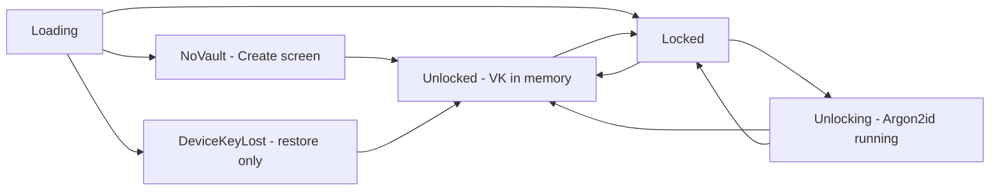

# Design notes

How Vault is put together and why. The security model itself (threats, key hierarchy, parameters) is in
[SECURITY.md](../SECURITY.md); this file covers structure, data, flows and the decisions behind them.

## Scope

One person, one phone, one vault. The first version had to do five things well: create the vault, unlock it, add
and edit entries, copy a secret, lock. Everything later (backup, biometrics, search, generator) is built on the same
key hierarchy, blob format and session, so those were designed once, with a schema that froze at the first release.

It deliberately does **not**:

- talk to a network (no `INTERNET` permission, checked at build time),
- sync, or share a database, account or API with any other app,
- offer a plaintext export, password recovery, or auto-wipe after failed attempts,
- use system autofill, cloud backup or Play Services.

## Modules and boundaries

One Gradle module, with package boundaries enforced by convention and by the tests:

| Package | Responsibility | Android imports |
|---------|----------------|-----------------|
| `crypto/` | Argon2id, calibration, AES-GCM blob format, key hierarchy (create, unlock, re-authenticate, change passphrase, export, restore), HKDF, `.pvault` codec, wiping helpers | Only `KeystoreDeviceWrap` and `KeystoreBiometricKey` |
| `domain/` | TLV entry codec, padding, AAD strings, passphrase rules, backoff, auto-lock and clipboard policies, search, tags, generator, settings codec, 7-day schedule | None |
| `data/` | Room entities, DAOs, migrations, `VaultRepository` | Room |
| `session/` | Session state machine, auto-lock driver, clipboard guard, keep-alive service, backoff store | Yes |
| `ui/` | Compose screens, `VaultViewModel`, incognito keyboard, biometric prompt wrapper | Yes |

Rules that hold across the code:

- **The UI never sees keys or blobs.** It gets `EntrySummary` / `EntrySecret` objects from the repository, and only
  while the session is unlocked.
- **`VaultRepository` is the only plaintext boundary.** All encryption and decryption of user data happens there.
- **Hardware is behind interfaces.** `DeviceWrap` and `BiometricKey` have Keystore implementations on the phone and
  in-memory fakes in the JVM tests, so `KeyHierarchy` and the repository flows are tested with real Argon2id and real
  AES-GCM.
- **Secrets stay out of saved state.** Nothing secret goes into `rememberSaveable`, `SavedStateHandle`, intents,
  notifications, logs or exception messages. Classes that hold secrets override `toString()` to redact, and a test
  checks it.

## Data model

Room database `vault.db`, current schema version 3. Encryption is per field, not per page.

```text
vault_meta (exactly one row)
  id, vaultId, formatVersion, kdfAlgorithm, kdfSalt, kdfMemoryKib, kdfIterations, kdfParallelism,
  wrappedVaultKey, deviceKeyAlias, createdAt,
  backupInfo     (v2, AEAD blob)
  biometricWrap  (v3, Keystore blob, null = biometric off)
  passphraseInfo (v3, device-wrapped timestamp)
  settings       (v3, AEAD blob, null = defaults)

entries
  id (random UUIDv4), formatVersion, summaryBlob, secretBlob
```

There are no indexes beyond the primary keys. Sorting and search run in memory over decrypted summaries, which is
cheap at personal-vault sizes and means no plaintext index ever touches the disk.

**Two blobs per entry.** The list needs titles and usernames, never passwords. The summary blob (title, username, URL,
created and updated times, tags) is decrypted for the list; the secret blob (password, notes) only on copy, reveal or
edit, and dropped right after.

**Payload codec** (`domain/EntryCodec.kt`). A version byte, then tag-length-value fields: 1-byte tag, varint length,
UTF-8 bytes. Unknown tags are skipped on decode, so new fields (tags in v0.3.0; TOTP and password history are
reserved) are added inside the blobs without a schema migration. Timestamps live inside the summary blob because when
an entry was made is metadata too.

**Migrations.** Schema JSON for every version is committed under `android/app/schemas/`. Each change is a real
`Migration` (`data/Migrations.kt`): v2 and v3 only add nullable `vault_meta` columns. There is no destructive fallback,
because the phone holds the only copy. `MigrationTest` applies the migration SQL with sqlite-jdbc to databases built
from the frozen JSON and compares the result column by column with the next exported schema.

**Delete** is a hard delete after a confirmation, with `PRAGMA secure_delete = ON`. With no sync there are no
tombstones to keep, and a "deleted" secret that is still on disk is not one the user expects to exist.

## Session and unlock flows



`VaultSession` is app-scoped and is the only holder of the VK. Each lock bumps a generation counter, so an Argon2id
run that finishes after the user (or a timeout) locked the vault has its key wiped instead of installed. The direct
Locked to Unlocked edge is biometric unlock; DeviceKeyLost to Unlocked is a restore from a `.pvault` file.

- **Create** is blocked until the phone has a secure lock screen, because the device-wrap key and the stolen-phone
  defence depend on it.
- **Unlock** unwraps the device layer first, so a missing Keystore key shows a recovery screen instead of a pointless
  passphrase prompt, then runs Argon2id on a background dispatcher.
- **Settings are decrypted before the session reports Unlocked**, so auto-lock starts with the user's timeouts.
- **Biometric unlock** is a two-step flow: the repository hands out a decrypt cipher for the prompt's `CryptoObject`,
  then opens the VK with the authenticated cipher. The SAF pickers and the biometric prompt are driven from the root
  composable, so a lock in the middle of a file pick does not lose the result.

## Lock and clipboard

`domain/AutoLockPolicy.kt` and `domain/ClipboardPolicy.kt` are pure functions of time and state, tested with a fake
clock. `session/AutoLock.kt` feeds them from the platform: a screen-off receiver registered only while unlocked,
`ProcessLifecycleOwner` start and stop, `Activity.onUserInteraction`, and a main-thread timer.

The tricky part was Android 14+, which freezes cached processes within seconds. A pending 60-second timer may then
never run, and neither would the 30-second clipboard clear. Two measures handle it:

1. `SessionService`, a plain started service (no notification, no permission), runs while the vault is unlocked and
   keeps the process out of the cached state. If Android stops it while the app is in the background, the vault
   locks.
2. The background deadline is re-checked on `ON_START` with `SystemClock.elapsedRealtime`, before the first frame is
   drawn, so a frozen process that wakes up late still locks.

## Backup, restore, change passphrase

The device-bound design has one big availability risk: a lost phone loses the vault. Encrypted export was therefore
the first feature after the core vault.

- **Export** re-proves the passphrase, then writes the passphrase layer of the key, the KDF header and every entry
  blob unchanged into a `.pvault` file, with an HMAC over the whole file. Since the same `pwWrap` goes into the file,
  the file provably opens with the passphrase that was just typed.
- **Restore** parses the file without a key (to preview the date and entry count), opens it with the passphrase,
  checks the MAC, creates a new device key and writes everything in one transaction. Restoring a backup of the same
  vault onto a phone whose device key was lost keeps the entries already on the phone (they open under the same VK
  and may be newer than the file).
- **Change passphrase** derives a new KEK with a new salt and re-calibrated iterations and re-wraps the same VK. The
  device key is reused, not regenerated, so a failed database write cannot strand the stored wrap. Entries are not
  touched; old exports still open with the old passphrase.
- The list shows "Last backup: …" and a reminder card when entries changed and the last export is older than 30
  days. That timestamp is stored encrypted, because when someone backs up is metadata too.

## Decisions and alternatives

| Decision | Rejected alternative | Reason |
|----------|---------------------|--------|
| Passphrase-derived key plus a Keystore wrap | Keystore-only key, or `EncryptedSharedPreferences` | Keystore-only means "phone unlocked" equals "vault open": a thief who saw the PIN gets everything. AndroidX Security Crypto is also deprecated. |
| Argon2id via Bouncy Castle | PBKDF2, scrypt, native libsodium | PBKDF2 is not memory-hard; Argon2id is the current RFC 9106 / OWASP recommendation. Pure JVM code avoids NDK builds and per-ABI native libraries, and runs unchanged in the JVM tests. libsodium was kept as the fallback if Bouncy Castle turned out too slow on the phone at the 64 MiB floor. |
| Field-level AEAD | SQLCipher | SQLCipher would only additionally hide the entry count and blob sizes, at the cost of a native library and a second key path. Padding already blurs sizes. |
| Platform JCA AES-GCM | Tink | Tink has no Argon2, and raw-key AEAD needs its "insecure" key access API. Two AEAD call sites do not need a keyset manager. |
| A separate random VK | Encrypt entries with the KEK directly | Passphrase change, export and biometric unlock each re-wrap 32 bytes instead of re-encrypting every entry. |
| Encrypted titles | Plaintext titles for sorting and search | Titles reveal which services the owner uses. Sorting in memory is free at this scale. |
| Framework `BiometricPrompt` | androidx.biometric | No new dependency, no Fragment; the activity stays a plain `ComponentActivity`. |
| Incognito keyboard through Compose `InterceptPlatformTextInput` | Wrapping `EditText` in `AndroidView` | One wrapper around the whole UI sets `IME_FLAG_NO_PERSONALIZED_LEARNING` on every field. |
| No auto-wipe | Wipe after N failures | Without a guaranteed backup, a wipe hurts the owner more than an attacker; Argon2id and the device wrap carry the offline defence. |
| Debug build with its own application id | Same id for debug and release | A signature mismatch would tempt an uninstall, and uninstalling deletes the vault. |

## What is next (not built)

- An Android autofill service with exact registrable-domain matching and no fill into unmatched apps without an
  explicit pick.
- TOTP codes from a secret stored in the secret blob (the codec tag is reserved).
- Import from Bitwarden JSON, KeePass KDBX and CSV, parsed in memory and never copied to app storage.

Sync is not planned. If it ever is, it would carry only ciphertext (blobs and the passphrase wrap) and needs its own
threat model first (server rollback, conflicts on encrypted rows).
